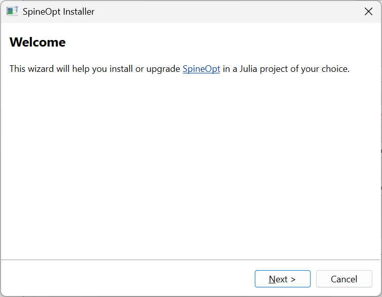
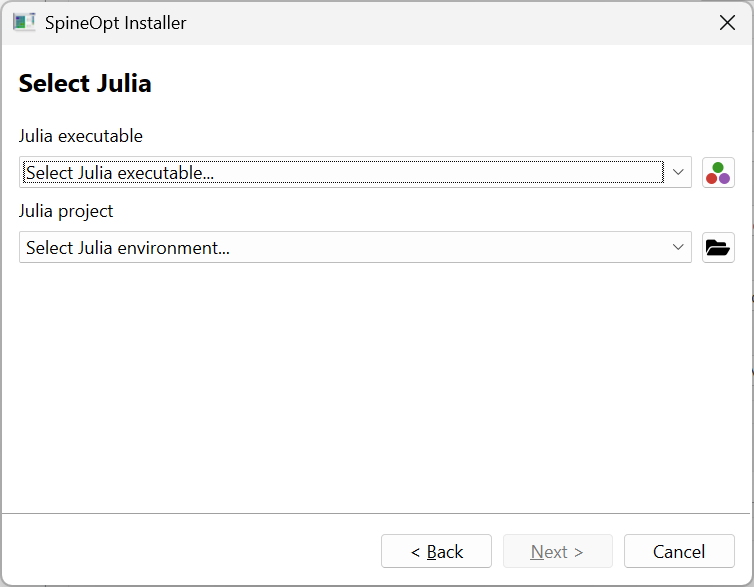
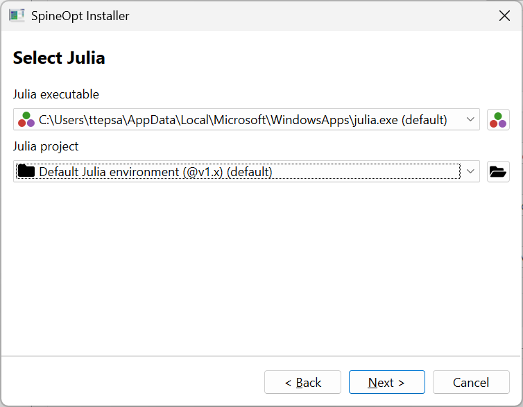
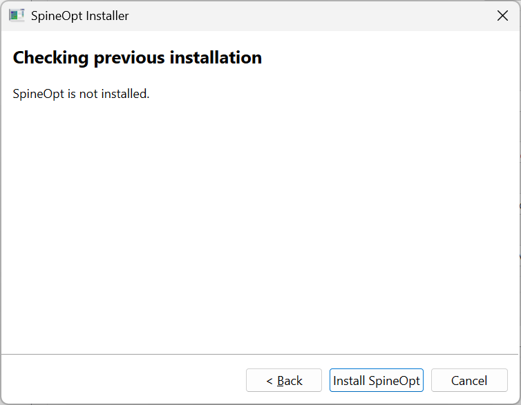
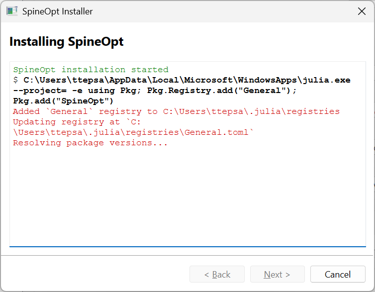
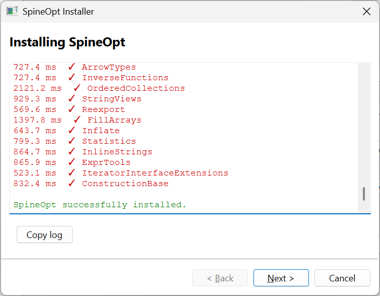
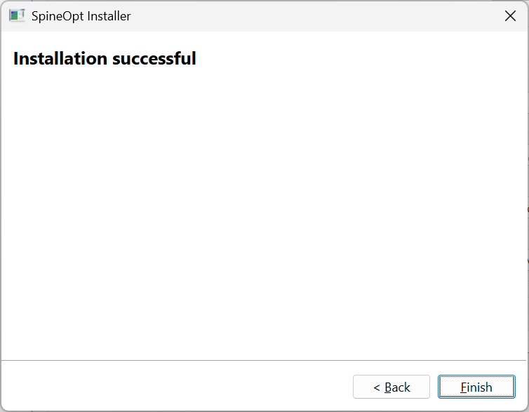
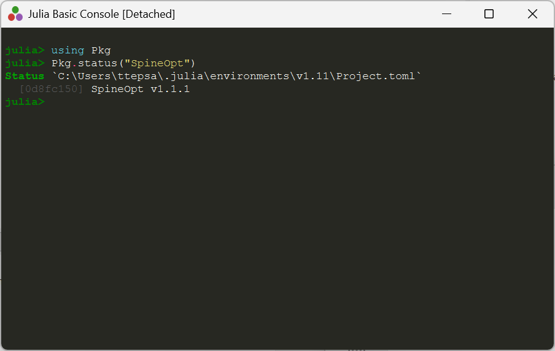

.. How to Set up SpineOpt.jl documentation

.. _How to Set up SpineOpt.jl:

******************************
SpineOpt.jl Installation Guide
******************************

Installing Julia
----------------

The recommended way to install Julia on all supported platforms is to use **Juliaup**, the official Julia installer
and version manager. Juliaup simplifies installation, automatically configures the system PATH, and makes it easy to
install and update Julia versions.

**Windows**

Install Julia from the **Microsoft Store** by searching for **Julia** and follow the on-screen instructions.

**macOS and Linux**

Open a terminal and run:

.. code-block:: console

   curl -fsSL https://install.julialang.org | sh

After installation, verify that Julia is available by running:

.. code-block:: console

   julia --version

Before proceeding, ensure that the ``julia`` command is available from your system PATH. If the command above does
not work, Julia may not have been added to your PATH correctly. For instructions on manually adding Julia to your
PATH, see the official Julia documentation:
https://julialang.org/downloads/platform/

As an alternative, Julia can also be installed directly from Spine Toolbox. Open **File -> Settings** and select the
**Tools** page. The **Install Julia** button launches a cross-platform installation wizard that uses Python's
``jill`` package to download and install the latest available Julia release. This can be a convenient option if
Julia is not already installed on your system.

After installation, verify that Spine Toolbox can locate your Julia installation:

#. Start Spine Toolbox

#. Select **File -> Settings** from the main menu and open the *Tools* page.

#. Confirm that the **Default Julia executable** field contains the path to your Julia executable. If Julia was added
   to your system PATH correctly, Spine Toolbox should detect it automatically.

   The page should look similar to the following:

   .. image:: img/settings_tools_default.png
      :align: center

#. If *Add path to Julia executable...* is shown in the **Default Julia executable** field, Spine Toolbox could
   not locate a Julia installation automatically. Click **Add Existing Julia** and select the Julia executable manually.
   At least one Julia executable must be configured before Spine Toolbox can use Julia-based tools.

Installing SpineOpt.jl
----------------------
**SpineOpt.jl** currently supports Julia versions from the current long-term support (LTS) release onward. At the
time of writing, this includes Julia 1.10 (LTS) through Julia 1.13.4 (latest stable release).

After installing Julia, you can install **SpineOpt.jl** from Spine Toolbox. Open **File -> Settings** and select the
**Tools** page. Then click **Add/Update SpineOpt** to open the **SpineOpt Installer** wizard.

Click **Next**.

On this page, select the Julia executable and the Julia environment (project) where **SpineOpt.jl** should be
installed.

For example, you can select the Julia executable found in your system PATH and use the **Default Julia environment**
as the target project. Alternatively, you can click the **Browse** button next to the Julia project field and select
an empty directory to create a new project dedicated to **SpineOpt.jl**.

When you are happy with your selections, click **Next**.

The wizard checks whether **SpineOpt.jl** is already installed in the selected Julia environment. If it is not
installed, the page will look similar to the one shown below. If **SpineOpt.jl** is already installed, an
**Update SpineOpt** button will be displayed instead of **Install SpineOpt**.

Please be patient. Installing **SpineOpt.jl** may take 5-15 minutes, depending on your systems performance and
network connection. Once the **Next** button becomes enabled, the installation has completed. Verify that the
final line of the installation log reads *SpineOpt successfully installed.*

Click **Next**.

Click **Finish** to close the wizard, and then click **Ok** to close the **Settings** window.

You are now ready to run **SpineOpt.jl** Tools in Spine Toolbox.

Verifying the installation
--------------------------

You can verify that **SpineOpt.jl** was installed successfully by opening a Julia console from the Spine Toolbox main
menu. Select **Consoles -> Start Julia -> <Julia executable> -> Default Julia environment (@v1.x)**, where
``<Julia executable>`` is the Julia executable that you selected in the SpineOpt installer wizard.

Run the following commands in the console:

.. code-block:: julia

   using Pkg
   Pkg.status("SpineOpt")

You should see output similar to the following:

|

.. tip::

   You can also run ``using SpineOpt`` to further verify that the package can be loaded successfully. The first load
   may take up to a minute to complete, so please be patient.

Installing the SpineOpt plugin
------------------------------

.. note::

   The SpineOpt plugin is not required to run **SpineOpt.jl**. It is provided for convenience and as a quick way to
   access common SpineOpt workflows from within Spine Toolbox.

#. Select **Plugins -> Install Plugin...** from the main menu.

#. Select **SpineOpt** from the list of available plugins and click **OK**.

#. After the installation has completed, a **SpineOpt plugin** toolbar will appear in the main window.

The SpineOpt plugin is installed globally and is available in all Spine Toolbox projects. Likewise, uninstalling the
plugin removes it from all projects.

Spine Toolbox, Julia, and **SpineOpt.jl** are now configured and ready to use.

To continue, see the `recommended workflow <https://spine-tools.github.io/SpineOpt.jl/latest/getting_started/recommended_workflow/>`_
in the SpineOpt documentation. You can also explore the `tutorials
<https://spine-tools.github.io/SpineOpt.jl/latest/tutorial/simple_system/>`_ for more advanced examples and use cases.

For more information about selecting a specific Python or Julia version, see
:ref:`Setting up Consoles and External Tools`.
